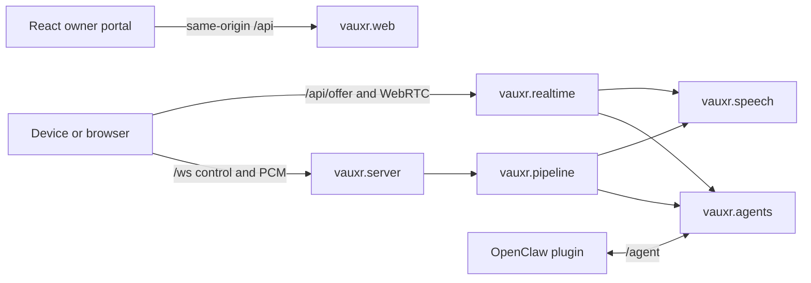

# Vauxr — system explanation

Vauxr is a Python 3.12 asyncio/aiohttp voice gateway. One application serves
HTTP management, device WebSockets and integration WebSockets; optional in-process
Pipecat provides WebRTC media. Wyoming speech services and LLM backends are
external dependencies, not part of the gateway process. Local speech/backends
can operate without cloud APIs; selecting a hosted provider requires its service.

## Runtime boundaries

`server.make_app()` installs transport, owner-session and operation-policy
middleware before registering routes. `run_server()` binds the **same app** on
8765 (conventionally WS) and 8080 (conventionally HTTP); these are not separate
security domains. Optional TLS adds another listener. Startup validates stored
configuration, credentials, speech and routing before serving traffic.

| Owner | Responsibility / source |
|---|---|
| `src/vauxr/server.py` | Device admission, connection identity, capture and realtime startup |
| `src/vauxr/web/` | Management APIs, owner cookies/CSRF, speech preview, webhooks, static UI |
| `src/vauxr/auth/` | Credential verification/current generation, operation policy, retained connection teardown |
| `src/vauxr/provisioning/` | Signed enrollment, integration pairing, durable credential lifecycle |
| `src/vauxr/agents/` | Routing metadata, inbound plugin transport, outbound direct OpenClaw, local adapters |
| `src/vauxr/pipeline.py` | Standard STT → agent/direct reply → segmented TTS and follow-up |
| `src/vauxr/realtime/` | Pipecat sessions, startup input ownership, output consumption, teardown and diagnostics |
| `src/vauxr/speech/` | Server-owned deployments, immutable selections, Wyoming/OpenAI adapters |
| `src/vauxr/devices/` | Device config, connected registry, metrics, firmware delivery |
| `src/vauxr/settings/`, `src/vauxr/plugins/` | Provider secrets/settings and bundled integration distribution |
| `web-client/src/` | React management portal and separately enrolled browser voice identity |

## Authority and persistence

`DATA_DIR` defaults to `/data` and must be writable. `config.json` owns server
settings; environment values bootstrap absent settings. `agents.json` owns routing
metadata, while `authz.json` owns credential/enrollment authority. `speech.json`
owns speech providers and inherited selections. Device settings and provider
secrets have their own stores; do not treat routing metadata as credentials or
copy tokens into configuration examples.

Owner access is an exact configured HTTP/HTTPS origin plus a console-bootstrapped
owner session, not a shared device token. Cookie-authenticated mutations require
Origin and CSRF checks. Devices and integrations have separate scoped bearer
credentials. Device operations bind to the authenticated device ID; display names
are metadata, never routing identities. Current credential generation and live
socket ownership are rechecked during use. Use [`auth/policy.py`](src/vauxr/auth/policy.py),
[`web/owner.py`](src/vauxr/web/owner.py) and
[`provisioning/`](src/vauxr/provisioning/) as the current implementation evidence. The [README](README.md#quick-start)
owns owner setup; [configuration](docs/configuration.md) owns persistence rules.

Browser voice persists its non-exportable Ed25519 private key and scoped device
credential in IndexedDB. Durable save/readback precedes credential ACK. Management
requests use the owner session through `web-client/src/auth/api.ts`; the browser
voice socket uses the separately enrolled device identity. Cross-origin Vite
serving is not an authenticated owner deployment.

## Device wire boundary

`protocol.py` parses JSON objects from **text** frames and audio from **binary**
frames. The first-byte JSON heuristic is a utility, not the server dispatcher.
Audio has a three-byte header: one type byte, two big-endian sequence bytes,
then PCM. Types are `0x01` microphone, `0x02` reply, `0x03` proactive push.
Standard microphone PCM is 16 kHz mono signed 16-bit; output rate is signalled
and negotiated, not inferred from the type byte. `audio.end.follow_up` controls
continued listening; it does not itself close a warm WebRTC session.

Initial device messages carry scoped credentials (`hello`, `voice.start` or
`realtime.start`). Later controls inherit the connection principal; supplying a
different identity/credential does not transfer ownership. See `WS_OPERATIONS`
in `auth/policy.py` for the allowlist and `server._authorize_message()` for checks.

### Realtime cold-to-warm handoff

The current physical-device startup is **ordered PCM streaming**, not the old
`voice.end.webrtc_connected` batch-transcription/text-seed protocol:

1. Device sends `realtime.start` with a nonzero 32-bit `startup_id`, then ordered
   WS microphone frames while signaling `/api/offer` with the same startup ID.
2. Device stops the WS capture writer before starting WebRTC media. It sends
   `realtime.media_ready` with `startup_id` and `next_seq` (the next 16-bit WS sequence).
3. `StartupAudio.finish_ws()` checks identity and sequence. WS input is drained
   before queued RTP, only after a consumer is bound and provider input is ready.
   Replayed audio is paced; overflow, sequence mismatch and timeouts fail startup.
4. Live RTP takes over after the FIFO drains. Warm re-wakes reuse the peer; pause,
   resume and stop are separate controls. Session teardown must not let an old
   wake's callbacks stop a replacement.

`StartupAudio` bounds retained audio to 15 seconds and setup to 20 seconds; paced
drain has a separate calculated timeout. These are implementation bounds, not
end-to-end latency promises. Browser/provider-specific live mode also exists in
`realtime/live.py`; it must not be confused with the standard Wyoming/channel path.

### Segmentation and speech selection

Standard turns resolve a speech selection at turn start. Deployments/endpoints
are server-owned; management clients select IDs. See
[speech configuration](docs/configuration.md) for inheritance and readiness limits.
Realtime segmentation settings in `devices/settings.py` currently return shared
defaults despite accepting `device_id`: idle segmentation is 1000 ms, sentence
segmentation takes precedence if enabled. The shared default taper is 8000 ms
active-idle and 180000 ms warm-quiet. These are not currently per-device overrides.

## OpenClaw boundary

Two transports are distinct:

- **Direct:** `agents/openclaw.py` connects outbound to the native OpenClaw gateway
  (`chat.send` / chat events), with gateway credentials and device session mapping.
- **Plugin:** `vauxr-openclaw` connects inbound to **`/agent`**, sends `agent.auth`,
  and waits for `agent.ready`. Standard traffic uses `agent.transcript` and
  `agent.response.delta/end/error` with device/run correlation. Realtime operations
  use `agent.realtime.request/result` with `requestId`. The server binds admission
  to the authenticated peer and routing identity, not just a client-provided ID.

Local cancellation of a waiting realtime operation removes its waiter; it does
not send backend cancellation (`AgentServer.realtime_request`). Do not assume
media teardown means an agent/tool operation was cancelled remotely. Direct chat
also lacks an overall response deadline and does not race device abort; output
ownership suppresses stale writes but does not guarantee abandoned-work cleanup.
A failed delayed direct reconnect can stop retries. See the [bounded findings](docs/maintainer-review-2026-11-09.md#additional-bounded-findings).

## Run, package and verify

Install the package for Python 3.12, then run `DATA_DIR=<writable-path> python3 -m vauxr`
or the installed `vauxr` command. `python3 -m server` is a pre-package command and
is no longer the entrypoint. Build the UI with `npm --prefix web-client run build`;
the backend resolves `web-client/dist` relative to its working directory.

`pyproject.toml` packages `src/vauxr`. Realtime is an optional extra pinned to
Pipecat 1.9.0; the Docker image installs realtime and ACME extras, builds the UI,
and runs as UID/GID 100:101 to preserve older volume ownership. Compose describes
external speech services. See [README](README.md) for installation and TLS setup.

CI runs backend tests with realtime dependencies, requires non-skipped media-authority
coverage, and runs web unit tests, container ownership smoke, design gates and
Playwright domain jobs. Full browser suites belong in CI, not this review's local
validation. [Review evidence](docs/maintainer-review-2026-11-09.md) records the pinned
source, sampled coverage, findings and remaining gaps; this page is not a full
audit or a replacement for the exact auth contracts.

Standard text queues are unbounded; ordered synthesis is not producer backpressure.
STT upload drain is outside its connection/transcript timeouts, and resampling uses
stateful filtering with chunk-local interpolation rather than chunk-invariant rate
conversion. STT failure does not always emit `audio.end`. These are current limits,
not guarantees of end-to-end cancellation or terminal control.

Enrollment/lifecycle/integration share one global 60-request/minute admission budget.
Firmware ACK retries are bounded; server ACK idempotency alone cannot guarantee
recovery from repeated lost replies. Physical pairing proves key possession and a
matching-code ceremony, not hardware attestation or independent dual approval.
Revocation tombstones survive credential-record restoration, not arbitrary full
snapshot rollback. Generic LAN-mode integration APIs and provisioning differ in
transport-boundary enforcement; see [authority distinctions](docs/maintainer-review-2026-11-09.md#authority-distinctions).

### Guided physical-device pairing

The enrollment proof response can carry server-synthesized welcome and code
announcements using the global default TTS provider/voice. The physical device
plays the welcome, then a short Action-button release speaks the code. Further
short presses repeat the same code until the existing five-minute window ends
or enrollment finishes. Code/audio remain in RAM only; approved credentials
still follow the existing signed redemption and durable-save flow.

The portal's **Pairing and access → Edit pairing messages** stores `intro` and
`code` text in `config.json` under `pairing.prompts`. Owner-session/CSRF-protected POSTs
to `/api/enrollment/v1/prompts` and `/save-prompts` read/write these settings.
The welcome is limited to 400 characters and must not contain `{code}`; the
code announcement is limited to 200 characters and must contain `{code}` once.
Codes contain exactly four digits. Each digit is expanded to a spoken word,
including leading zeros. The five-attempt limit and five-minute expiry remain. The portal
collects the matching code once and performs the existing initiate/approve
requests on one explicit approval click; both server checks remain in place.

Firmware opts in on the signed `/prove` request using
`Accept: application/vnd.vauxr.pairing-audio`. The response is `VPA1`, a 32-bit
little-endian JSON byte length, a 32-bit little-endian welcome PCM byte length,
the usual UTF-8 proof JSON (plus `guided: true` and `intro_text`), welcome PCM,
and code PCM. Both clips are 16 kHz mono S16LE, bounded to 40 and 20 seconds
respectively. The JSON prefix is bounded to 4096 bytes. Synthesis uses at most
two concurrent slots and a 35-second timeout; busy/unavailable speech returns
JSON with the same guided flow and a local USB-console fallback. Audio has no
public URL and is not persisted or logged. Legacy clients receive the unchanged
JSON proof response. All responses retain `Cache-Control: no-store`.

## Why these boundaries matter

### Selection is not authority or readiness

Routing metadata answers *which agent*, speech configuration answers *which
deployment*, and credentials answer *who may act*. They are separate stores and
checks. This means a visible agent/provider can still be unavailable, and removing
a display entry is not a substitute for credential retirement. Standard speech
selections are frozen per turn: configuration changes affect later work rather
than mutating a deployment halfway through its response. Device overrides layer
on agent/global policy; they cannot enable voice for a chat-only agent.

### Sent, consumed and heard are different observations

A completed synthesis or send does not prove the speaker played the reply. The
realtime path tracks media consumption and response boundaries before follow-up
transitions. Startup separately waits for a bound consumer and provider readiness;
opening a peer alone is insufficient. The prefill buffer absorbs an initial burst
without changing downstream pacing; it cannot compensate for a producer that
remains slower than playback.

### Cancellation is ownership transfer, not rollback

A reconnect or replacement turn can leave old callbacks completing later. Registry
entry and abort-handle identity prevent those callbacks from clearing or resuming
a new owner's session. Authority teardown retains even superseded transports so
revocation can still close them. These local guarantees do not undo an external
tool action or prove remote cancellation. After a lost response, inspect actual
state before retrying.

### The portal is not an arbitrary execution environment

Owner management and enrolled browser voice use different authority. Companion
context is explicitly untrusted descriptive data, bound to current authority and
a revision; UI events need correlated receipts. The static interface accepts only
bounded HTML/CSS with sanitization and CSP. It does not provide shell, script or
network execution. These are implemented boundaries, not claims that every
provider or browser error path has been fault-tested.

For guided practice see the [tutorial](docs/tutorial.md), for operational steps
see [how-to guides](docs/how-to.md), and for exact limits see [reference](docs/reference.md).
